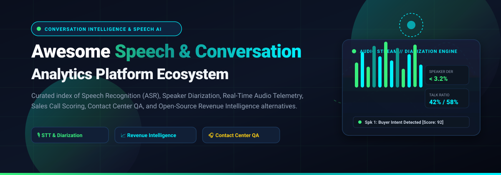
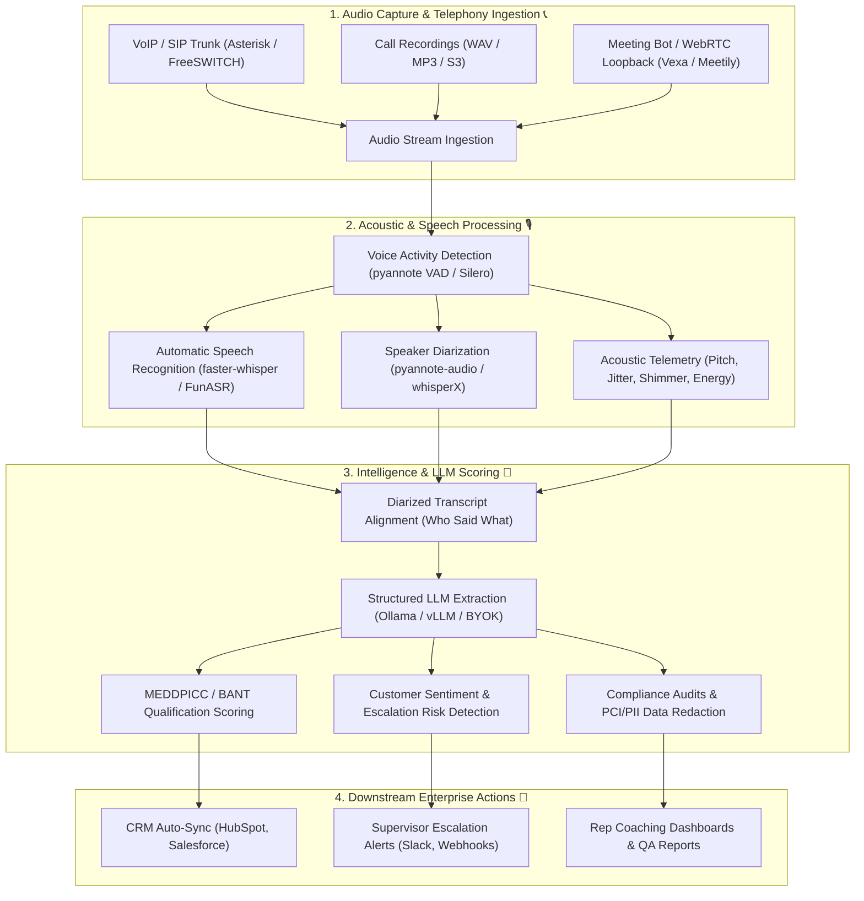

# Awesome-Speech-Conversation-Analytics

# 🎙️ Awesome Speech & Conversation Analytics 🚀

**A curated index of top Speech and Conversation Analytics platforms — both SaaS/Hosted commercial enterprise solutions and self-hosted open-source software for transcribing, diarizing, analyzing, and extracting actionable intelligence from sales calls, contact center interactions, and audio meetings.**

🌟 *Star this repository if you find it helpful!* 🌟

[📈 Market Overview](#-sector-overview--market-dynamics) • [🟦 SaaS Platforms](#-saas--hosted-platforms) • [🟩 Open-Source Software](#-open-source-software) • [📊 Stack Architecture](#-composable-speech-analytics-stack-architecture) • [🔍 SEO & Architecture Guide](#-seo--technical-guide-speech--conversation-analytics) • [⭐ Star History](#-star-history) • [💖 Support](#-support) • [🤝 Contributing](#-contributing)

---

## 📋 Table of Contents

- [📈 Sector Overview & Market Dynamics](#-sector-overview--market-dynamics)
- [🟦 SaaS / Hosted Platforms](#-saas--hosted-platforms)
  - [📊 SaaS Platforms Matrix](#-saas-platforms-matrix-sorted-by-scale--valuation)
  - [🔍 Detailed SaaS Platform Profiles](#-detailed-saas-platform-profiles)
- [🟩 Open-Source Software](#-open-source-software)
  - [⭐ Open-Source Software Matrix (Ranked by Stars)](#-open-source-software-matrix-ranked-by-stars)
  - [🛠️ Detailed Open-Source Project Profiles](#️-detailed-open-source-project-profiles)
- [📊 Composable Speech Analytics Stack Architecture](#-composable-speech-analytics-stack-architecture)
- [🔍 SEO & Technical Guide: Speech & Conversation Analytics](#-seo--technical-guide-speech--conversation-analytics)
- [⭐ Star History](#-star-history)
- [💖 Support](#-support)
- [🤝 Contributing](#-contributing)
- [📄 License](#-license)

---

## 📈 Sector Overview & Market Dynamics

The global Speech Analytics and Conversation Intelligence market is valued between **$2.8 billion and $3.5 billion** and is projected to expand at a robust compound annual growth rate (**CAGR of 14% to 18%**), surpassing **$8 billion by the early 2030s**.

This sector remains **moderately to highly fragmented** rather than a winner-take-all monopoly. Enterprise conversation data spans diverse, specialized departments:
- 💼 **Sales & Revenue Operations (RevOps)**: Captured by revenue intelligence leaders like Gong and Chorus by ZoomInfo.
- 🎧 **Contact Center QA & Compliance**: Dominated by enterprise workforce management platforms like Verint, CallMiner, and Observe.AI.
- 🎯 **Inbound Marketing Attribution**: Led by specialized call-tracking platforms like Invoca.
- 🔒 **Self-Hosted / Privacy-First Edge**: Rapidly expanding through open-source foundation models (Whisper, faster-whisper, pyannote) and on-device meeting assistants where audio recordings must never leave internal infrastructure due to GDPR, HIPAA, and proprietary compliance standards.

---

## 🟦 SaaS / Hosted Platforms

Commercial, cloud-hosted Speech and Conversation Analytics platforms. The table below compares commercial vendors, sorted in descending order by enterprise scale, corporate valuation, and annual revenue.

### 📊 SaaS Platforms Matrix (Sorted by Scale / Valuation)

| Company / Product | Category / Primary Focus | Company Size (Valuation / Revenue) | Starting Tier Pricing | Free Tier / Trial Limit | Key Highlights |
|:---|:---|:---|:---|:---|:---|
| **[Gong](https://www.gong.io/)** | 📈 Revenue Intelligence & Sales CI | **$7.25B Valuation** (~$500M ARR run rate) | **$1,300–$1,600 /user/yr** + $5,000–$50,000/yr platform fee | **No permanent free tier**; sales-assisted pilot/demo upon request | Pioneer in deal progression risk scoring, MEDDPICC tracking, and AI coaching. |
| **[Clari Copilot](https://www.clari.com/)** | ⚡ RevOps & Conversation Intelligence | **$2.60B Valuation** (~$180M–$450M Revenue) | **$1,080 /user/yr** (~$90–$100/user/mo billed annually) | **No permanent free tier**; 14-day sales demo/proof-of-concept on request | Real-time agent live battlecards, call recording, and pipeline forecasting alignment. |
| **[Verint](https://www.verint.com/)** | 🏛️ Enterprise CX & Speech Analytics | **$1.24B Market Cap** (~$900M TTM Revenue, NASDAQ: VRNT) | **~$1,500 /month** base enterprise deployment threshold | **No permanent free tier**; customized enterprise guided proof-of-concept | Omnichannel speech and text analytics, automated compliance audits, and contact center WFM. |
| **[Chorus by ZoomInfo](https://www.zoominfo.com/)** | 🤝 B2B Conversation Intelligence | **$1.15B Market Cap** (~$1.23B Parent Revenue, NASDAQ: ZI; $547M acquisition) | **$8,000 /year** (entry package for 3 seats; ~$1,000–$1,200/seat/yr thereafter) | **No permanent free tier**; 14-day limited sales trial available upon request | Integrated directly with ZoomInfo's proprietary B2B firmographic database and buyer intent signals. |
| **[Invoca](https://www.invoca.com/)** | 📞 Marketing Attribution & Call CI | **$1.10B Valuation** (>$100M ARR, Series F) | **~$1,000 /month** entry base contract (scales with call volume & digital spend) | **No permanent free tier**; 14-day guided enterprise sandbox pilot upon request | Inbound call tracking, campaign ROAS attribution, and automated intent detection. |
| **[Observe.AI](https://www.observe.ai/)** | 🤖 Contact Center AI & Agent Coaching | **~$1.00B Valuation** (~$44M–$73M Est. Revenue, Post-Series C) | **~$1,200 /agent/yr** (~$100/seat/mo, typical 100-seat minimum contract) | **No permanent free tier**; 14-day custom enterprise evaluation pilot upon request | Automated 100% call evaluation, QA scorecards, and live in-call coaching suggestions. |
| **[CallMiner](https://callminer.com/)** | 🔍 Omnichannel Interaction Analytics | **~$400M Valuation** (~$50M–$70M Est. Revenue) | **~$100,000 /year** enterprise contract minimum threshold | **No permanent free tier**; 30-day CallMiner Record evaluation pilot on request | 20+ year enterprise standard in acoustic emotion tracking, PCI-DSS redaction, and compliance QA. |
| **[Balto](https://www.balto.ai/)** | ⏱️ Real-Time Live Call Guidance | **~$150M Valuation** (~$22M Est. Revenue, $52M total funding) | **~$101,000 /year** median enterprise contract (or consumption per-minute voice agents) | **No permanent free tier**; 30-day supervised contact center pilot upon request | Real-time dynamic speech recognition prompting agents live while on customer calls. |
| **[Tethr](https://tethr.com/)** | 📊 Effort Scoring & Customer Insights | **~$60M Valuation** (~$18M Est. Revenue, merged into Creovai) | **~$1,200 /user/yr** (~$100/seat/month custom enterprise tier) | **No permanent free tier**; 14-day sales-managed sandbox trial upon request | Proprietary Tethr Effort Index (TEI) measuring customer friction, churn risk, and sentiment. |

---

### 🔍 Detailed SaaS Platform Profiles

#### 🏆 Gong
- **Category:** Revenue intelligence and sales conversation analytics 📈
- **Profile:** Gong is the category-defining revenue intelligence platform, analyzing sales calls, emails, and meetings to surface deal risks, coaching opportunities, and revenue insights. It provides automated call recording, transcription, sentiment analysis, talk-time metrics, and deal progression tracking.

#### 🎯 Clari Copilot
- **Category:** Revenue operations with conversation intelligence ⚡
- **Profile:** Formerly Wingman, Clari Copilot provides call recording, transcription, and real-time battlecards for sales reps, tightly coupled with Clari's broader pipeline inspection and forecasting suite.

#### 🏢 Verint
- **Category:** Enterprise workforce engagement and speech analytics 🏛️
- **Profile:** Verint provides enterprise-scale speech analytics as part of its workforce engagement suite, covering compliance monitoring, automated quality scoring, and customer experience signals for thousands of concurrent call center agents.

#### 🌐 Chorus by ZoomInfo
- **Category:** Conversation intelligence for B2B sales teams 🤝
- **Profile:** Chorus captures sales calls, emails, and meetings, matching conversation keywords against ZoomInfo’s database of company profiles and buying intent signals.

#### 📞 Invoca
- **Category:** Call intelligence for marketing and contact centers 🎯
- **Profile:** Invoca specializes in tracking and analyzing inbound phone calls to attribute revenue to paid search and digital ads, evaluating buyer intent, lead qualification, and agent performance.

#### 🤖 Observe.AI
- **Category:** Contact center AI with agent assistance 🎧
- **Profile:** Observe.AI analyzes 100% of customer interactions across voice and chat, replacing manual QA sampling with AI-driven scoring, auto-summary generation, and supervisor coaching workflows.

#### 🛡️ CallMiner
- **Category:** Enterprise speech and interaction analytics 🔍
- **Profile:** A pioneer in speech analytics, CallMiner Eureka analyzes omnichannel conversations for sentiment, emotion, root-cause friction, and strict regulatory compliance (PCI-DSS and HIPAA audio redaction).

#### ⏱️ Balto
- **Category:** Real-time guidance and conversation analytics ⚡
- **Profile:** Unlike post-call analytics tools, Balto listens to conversations in real time, delivering instant on-screen prompts, checklist reminders, and objection-handling battlecards directly to agent screens.

#### 📉 Tethr
- **Category:** AI-powered conversation analytics and customer effort scoring 📊
- **Profile:** Tethr maps voice conversations against behavioral research frameworks, quantifying customer effort (TEI score), churn probability, and agent empathy directly from audio transcripts.

---

## 🟩 Open-Source Software

Self-hosted, privacy-first, community-driven speech recognition, speaker diarization, meeting transcription, and call analytics toolkits. 

### ⭐ Open-Source Software Matrix (Ranked by Stars)

| Repository | GitHub_Stars_Badge | Primary Role | Core Stack | License | Key Capabilities |
|:---|:---:|:---|:---|:---|:---|
| **[OpenAI Whisper](https://github.com/openai/whisper)** |  | 🎙️ Foundation ASR Engine | Python / PyTorch | MIT | Industry-standard speech-to-text model trained on 680,000 hours of multilingual audio. |
| **[whisper.cpp](https://github.com/ggerganov/whisper.cpp)** |  | ⚡ High-Performance On-Device ASR | C / C++ | MIT | High-performance C/C++ port with zero dependencies, Apple Silicon Metal, and CPU acceleration. |
| **[meetily](https://github.com/Zackriya-Solutions/meetily)** |  | 🛡️ Privacy-First Meeting Assistant | Rust / React / Whisper | MIT | Self-hosted desktop meeting note-taker and Otter/Granola alternative with on-device diarization. |
| **[faster-whisper](https://github.com/SYSTRAN/faster-whisper)** |  | 🚀 Optimized Whisper Engine | Python / CTranslate2 | MIT | Re-implementation using CTranslate2, delivering up to 4x faster inference with less memory. |
| **[whisperX](https://github.com/m-bain/whisperX)** |  | 🎯 Word-Level ASR + Diarization | Python / PyTorch | BSD-2-Clause | Forced phoneme alignment with wav2vec 2.0 and pyannote integration for word-level speaker timestamps. |
| **[screenpipe](https://github.com/screenpipe/screenpipe)** |  | 🖥️ 24/7 Audio & Screen Intelligence | Rust / SQLite / Whisper | Apache-2.0 | Continuous, local recording and indexing of mic, system audio, and screen for AI context retrieval. |
| **[FunASR](https://github.com/modelscope/FunASR)** |  | 🏭 Industrial Speech Intelligence | Python / PyTorch / C++ | MIT | Enterprise speech recognition toolkit with VAD, ASR, PUNC, and speaker diarization models. |
| **[pipecat](https://github.com/pipecat-ai/pipecat)** |  | 🤖 Voice Agent & Pipeline Telemetry | Python | BSD-2-Clause | Real-time framework for voice AI agents, tracking turn-by-turn latency, interruptions, and transcripts. |
| **[pyannote-audio](https://github.com/pyannote/pyannote-audio)** |  | 👥 Neural Speaker Diarization | Python / PyTorch | MIT | State-of-the-art neural building blocks for speaker diarization, voice activity detection, and overlap detection. |
| **[whisper-diarization](https://github.com/MahmoudAshraf97/whisper-diarization)** |  | 📦 Turnkey Whisper + Diarization | Python / PyTorch | MIT | Simplified pipeline pairing Whisper with pyannote speaker segmentation for automated call analysis. |
| **[vocode-core](https://github.com/vocodedev/vocode-core)** |  | 📞 Conversational Voice AI Platform | Python / TypeScript | MIT | Orchestrates telephony, microphone, speech-to-text, and LLMs for interactive voice conversations. |
| **[ghost-pepper](https://github.com/matthartman/ghost-pepper)** |  | 🔒 Private On-Device Meeting Notes | Swift / Metal | MIT | 100% private, on-device voice model runner for macOS speech-to-text and meeting transcription. |
| **[vexa](https://github.com/Vexa-ai/vexa)** |  | 🤖 Meeting Bot & Transcription API | Python / TypeScript | Apache-2.0 | Auto-joins Google Meet, Microsoft Teams, and Zoom to capture live WebSocket audio streams and transcripts. |
| **[muesli](https://github.com/Muesli-HQ/muesli)** |  | 📝 Local Meeting Notes & Dictation | Swift / Rust | MIT | Agent-native local meeting transcription and dictation app for macOS (Granola & WisprFlow alternative). |
| **[Speech-Emotion-Recognition](https://github.com/Renovamen/Speech-Emotion-Recognition)** |  | 🎭 Acoustic Emotion Detection | Python / Keras | MIT | Recognizes caller emotion (anger, happiness, sadness, neutral) from vocal acoustic features. |
| **[VoiceFlow](https://github.com/infiniV/VoiceFlow)** |  | 🎙️ Local Meeting & Voice Recorder | Python / C++ | MIT | Records system audio and microphone with local Whisper transcription and BYOK LLM summary generation. |
| **[Biscotti](https://github.com/scosman/Biscotti)** |  | ☕ Private Meeting Transcription | Swift / macOS | MIT | Free, private meeting transcription application for macOS powered by local whisper engines. |
| **[cdr-stats](https://github.com/cdr-stats/cdr-stats)** |  | 📊 Telephony CDR Analytics | Python / Django | AGPL-3.0 | Call detail record (CDR) analytics and call center metrics for FreeSWITCH, Asterisk, and Kamailio. |
| **[Nebulynk](https://github.com/sapientorius/Nebulynk)** |  | 🌐 Team Conversation Hub | TypeScript / Python | Apache-2.0 | Self-hosted home for team conversations, customer calls, meeting transcripts, and AI-assisted follow-ups. |
| **[amazon-transcribe-live-call-analytics](https://github.com/aws-samples/amazon-transcribe-live-call-analytics)** |  | ☁️ Live Call Center Analytics | Python / CloudFormation | MIT-0 | Reference architecture for real-time speech analytics, sentiment tracking, and agent assistance. |
| **[amazon-transcribe-post-call-analytics](https://github.com/aws-samples/amazon-transcribe-post-call-analytics)** |  | 🗄️ Post-Call Processing Pipeline | Python / Lambda | MIT-0 | Serverless post-call transcription, automated PII redaction, sentiment curves, and supervisor dashboard. |
| **[Callytics](https://github.com/bunyaminergen/Callytics)** |  | 💡 Contact Center Speech & LLM Analytics | Python / Streamlit | MIT | Contact center call analytics solution combining speech recognition and LLMs to analyze customer service calls. |
| **[Vox-Intel-Engine](https://github.com/ronitgupta138/Vox-Intel-Engine)** |  | 📡 Real-Time Acoustic DSP & Telemetry | Python / FastAPI | MIT | Real-time acoustic DSP extracting pitch autocorrelation, FFT spectral energy, and talk pacing metrics. |

---

### 🛠️ Detailed Open-Source Project Profiles

- #### ⚡ **[OpenAI Whisper](https://github.com/openai/whisper)** & **[faster-whisper](https://github.com/SYSTRAN/faster-whisper)**
  - **Role:** Foundational Speech Recognition Engine 🎙️
  - **Why It Matters:** The undisputed standard in open-source ASR. Using `faster-whisper` (CTranslate2 implementation) reduces memory usage and achieves a 4x throughput speedup on both CPUs and GPUs, enabling cost-effective processing of massive call recording backlogs.

- #### 🎯 **[whisperX](https://github.com/m-bain/whisperX)**
  - **Role:** Word-Level Timestamps & Phoneme Alignment ⏱️
  - **Why It Matters:** Resolves Whisper's timestamp drift by integrating wav2vec 2.0 forced alignment and pyannote speaker diarization. Essential for verifying exactly which speaker uttered a specific buying signal or objection.

- #### 👥 **[pyannote-audio](https://github.com/pyannote/pyannote-audio)**
  - **Role:** State-of-the-Art Neural Speaker Diarization 🧠
  - **Why It Matters:** The industry standard for separating "who spoke when." Provides pretrained models for voice activity detection (VAD), speaker embedding extraction, and clustering with low Diarization Error Rates (DER).

- #### 🛡️ **[meetily](https://github.com/Zackriya-Solutions/meetily)** & **[Muesli](https://github.com/Muesli-HQ/muesli)**
  - **Role:** Local-First Meeting Intelligence & Note-Taking 📝
  - **Why It Matters:** Open-source, botless desktop applications (macOS/Windows) providing private on-device transcription, speaker identification, and BYOK LLM summarization without joining calls via third-party recording bots.

- #### 📊 **[Callytics](https://github.com/bunyaminergen/Callytics)** & **[Vox-Intel-Engine](https://github.com/ronitgupta138/Vox-Intel-Engine)**
  - **Role:** Contact Center Call Intelligence & Acoustic Telemetry 📡
  - **Why It Matters:** Turnkey frameworks analyzing call center audio recordings for customer sentiment, agent talk ratios, interruption counts, and acoustic vocal pitch variations.

---

## 📊 Composable Speech Analytics Stack Architecture

You can construct a production-ready, sovereign, self-hosted Speech & Conversation Analytics platform without vendor lock-in by assembling modular open-source layers:

---

## 🔍 SEO & Technical Guide: Speech & Conversation Analytics

### What is Speech Analytics? 🎙️
Speech Analytics refers to the automated analysis of audio recordings from phone conversations, contact center interactions, and virtual meetings. Modern speech analytics leverages deep learning ASR (Automatic Speech Recognition) models, acoustic signal processing (DSP), and Natural Language Processing (NLP) to convert raw voice streams into structured business intelligence.

### What is Conversation Intelligence (CI)? 🧠
While legacy speech analytics focused strictly on phonetic keyword spotting, **Conversation Intelligence (CI)** uses contextual LLMs and transformer networks to evaluate conversational context, buyer intent, customer friction, objection handling, and rep adherence to sales methodologies (such as MEDDPICC, BANT, and Challenger Sale).

### Key Technical Metrics in Conversation Analytics 📏
1. **Word Error Rate (WER)**: The standard benchmark measuring speech-to-text accuracy:
   $$\text{WER} = \frac{S + D + I}{N}$$
   *(where $S$ is substitutions, $D$ is deletions, $I$ is insertions, and $N$ is total spoken words)*. Modern foundation models typically achieve $< 4\%\text{ WER}$.
2. **Diarization Error Rate (DER)**: Measures the proportion of speech time that was attributed to incorrect speakers or missed completely.
3. **Talk-to-Listen Ratio**: The conversational balance between sales rep and prospect. Top-performing reps consistently maintain an optimal ~43:57 talk-to-listen ratio.
4. **Latency & Real-Time Telemetry**: For live call coaching (like Balto or Vox-Intel-Engine), speech inference and battlecard retrieval must execute within $< 800\text{ms}$ of speaker pauses to be actionable.

---

## ⭐ Star History

---

## 💖 Support

Thank you for visiting and using this curated directory! 🌟

If you find this repository valuable:
- ⭐ **Star this repository** to show support and boost discoverability!
- 🍴 **Fork it** to customize or build your own curated knowledge hub.
- 📢 **Share it** on social platforms (LinkedIn, X/Twitter, Reddit) or with your engineering, RevOps, and data teams.
- ☕ **Sponsor / Buy a Coffee**: Support ongoing open-source curation and development via the [GitHub Sponsors Dashboard](https://github.com/sponsors/ishandutta2007).

Your backing makes open-source knowledge sharing sustainable and impactful! 🙌

---

## 🤝 Contributing

Contributions to expand and refine this curated index are warmly welcomed! 🌟

1. 🍴 **Fork the repository**.
2. 🌿 **Create a new branch** (`git checkout -b feature/add-new-tool`).
3. ✏️ **Add your entry** under the appropriate table or section following the existing format:
   - Tool Name and link
   - Category (SaaS or Open Source)
   - Specific pricing model and free-tier/trial limitations
   - Open-source GitHub repository link with valid Stars_Count badge
4. 🚀 **Commit your changes** (`git commit -m "feat: add new speech analytics tool"`).
5. 📬 **Submit a Pull Request** with a concise description of the software.

---

## 📄 License

This repository and curated list are released under the [Creative Commons Zero v1.0 Universal](LICENSE) (CC0 1.0 - Public Domain). 

All software products, trademarks, and registered logos belong to their respective corporate owners.

---

⭐ **If this directory helped you discover valuable speech analytics and conversation intelligence tools, please star this repository!** ⭐

[⬆ Back to Top](#-awesome-speech--conversation-analytics-)

